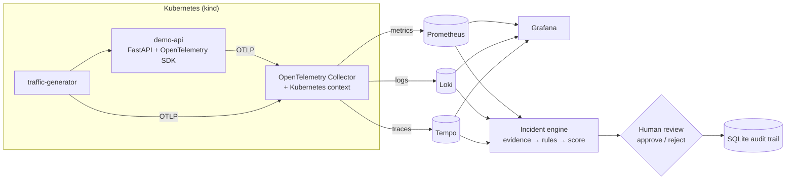
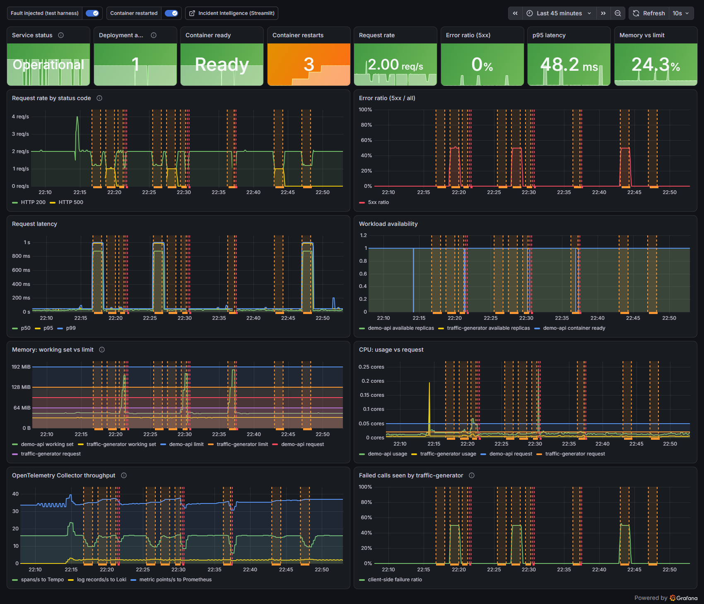
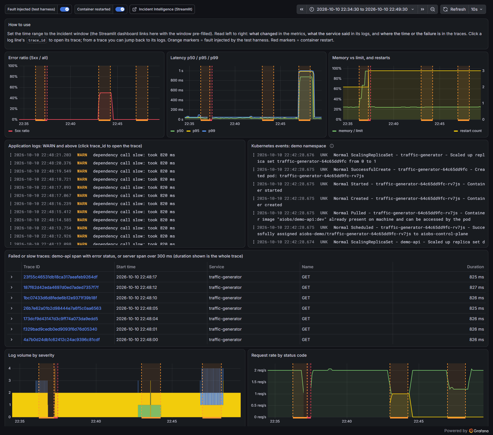
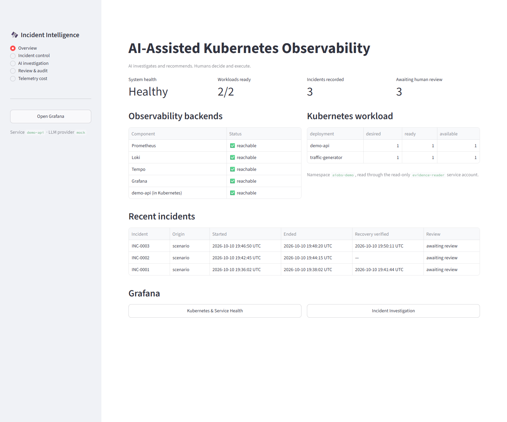
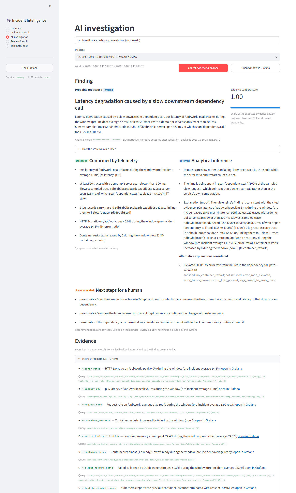
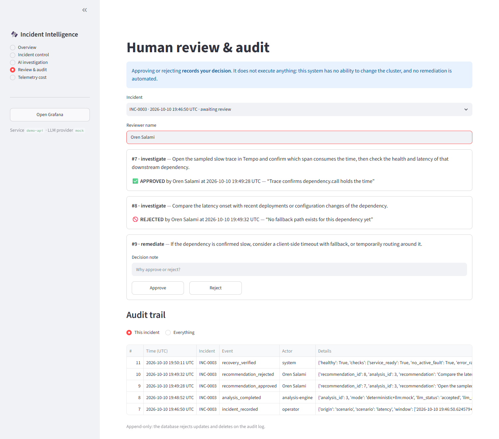

# AI-Assisted Kubernetes Observability & Incident Intelligence

## What

A small, fully local system that runs a real workload on Kubernetes, collects its metrics, logs and traces with OpenTelemetry, and turns that telemetry into an evidence-based incident analysis. An engineer reviews the analysis, approves or rejects each recommendation, and every step is recorded in an audit trail.

## Why

Monitoring tells you *what* happened: latency went up, errors spiked, a pod restarted. During an incident the harder questions are *what most likely caused it, which evidence supports that, how sure are we, and what should I look at next*. Answering them usually means jumping between a metrics dashboard, a log search and a trace viewer and joining the pieces by hand.

## How

1. A FastAPI service runs in a local Kubernetes cluster (kind) and is instrumented with the **OpenTelemetry SDK**.
2. An **OpenTelemetry Collector** in the cluster adds Kubernetes context and sends metrics to Prometheus, logs to Loki and traces to Tempo.
3. When an incident window is analysed, an evidence collector queries those backends and the Kubernetes API, read-only.
4. A deterministic rule engine correlates the signals — same service, same time window, shared trace id — and scores each hypothesis by how much of its expected evidence was actually observed.
5. Optionally, an LLM adds an explanation. Its output is validated against the evidence and discarded if it is not grounded.
6. A human approves or rejects each recommendation. Nothing is executed automatically.

> **AI investigates and recommends. Humans decide and execute.**

## Architecture



The workload and the Collector run in Kubernetes. Prometheus, Loki, Tempo, Grafana and the Streamlit dashboard run in Docker Compose. Details and the incident workflow diagram are in [docs/ARCHITECTURE.md](docs/ARCHITECTURE.md).

## How to run

Requirements: Windows with Docker Desktop running and PowerShell 7. About 3 GB of free memory. `kind` is downloaded into `.tools/` on first run if it is not installed.

```powershell
.\scripts\start.ps1      # create the cluster, deploy, start backends and dashboard
.\scripts\verify.ps1     # read-only health and pipeline checks
.\scripts\stop.ps1       # stop everything, keep all data
.\scripts\cleanup.ps1    # dry run; add -Force to remove the cluster and volumes
```

| | |
|---|---|
| Incident dashboard | http://localhost:18501 |
| Grafana (anonymous read-only) | http://localhost:13000 |
| demo-api on Kubernetes | http://localhost:18080/api/status |

Everything is bound to `127.0.0.1`. No cloud account, API key or paid service is needed.

Run the tests:

```powershell
.\.venv\Scripts\python -m pytest tests/unit          # no running system needed
docker compose --profile test run --rm tests         # integration + E2E against the live system (~8 min)
```

## Demo scenarios

Trigger them from **Incident control** in the dashboard. Each is bounded and recovers.

| Scenario | What is injected | What the analysis should find |
|---|---|---|
| **A — Latency degradation** | 800 ms added to the service's dependency call for 90 s | Latency degradation; the time is in the `dependency.call` span |
| **B — Elevated error rate** | Every second request fails with HTTP 500 for 90 s | Application errors in the dependency call path |
| **C — Memory exhaustion** | Memory grows until the container hits its 192 MiB limit | Container OOM-killed and restarted by Kubernetes |

Then open **AI investigation**, click *Collect evidence & analyse*, and decide on the recommendations under **Review & audit**. More in [docs/INCIDENT_SCENARIOS.md](docs/INCIDENT_SCENARIOS.md).

## Screenshots

All captured from the running system.

**Grafana — Kubernetes & Service Health**


**Grafana — Incident Investigation** (metrics, logs and traces for one incident window)


**Incident dashboard — overview**


**Root-cause analysis with evidence**


**Human review and audit history**


## What was demonstrated

Verified on the development workstation on 2026-10-10. Details and test output: [docs/TEST_REPORT.md](docs/TEST_REPORT.md).

- **A real workload on Kubernetes.** Two deployments on a kind cluster, with probes, resource limits, non-root containers and a read-only root filesystem.
- **OpenTelemetry end to end.** One request is traceable in all three signals: its metric series, its log record in Loki and its trace in Tempo share the service identity, the pod name and the trace id. All telemetry flows through one OpenTelemetry Collector with separate metrics, logs and traces pipelines.
- **Three incidents, correctly classified from telemetry alone.** In end-to-end tests each injected fault was detected in live telemetry, classified as the right cause without being told which fault was injected, and followed by a recovery confirmed from telemetry.
- **Correlated investigation.** For the latency and error incidents the finding cites a metric, a sampled trace, and a log record joined to that trace by trace id, all from the same window.
- **Grounding is enforced.** Missing backends are reported as missing evidence (tested by stopping Loki). Ungrounded, contradictory or command-bearing LLM output is rejected, including when a log line carries a prompt injection.
- **Humans decide.** Approvals and rejections are recorded with reviewer, note and time in an append-only audit log. The analysis code cannot run commands, and its Kubernetes token is read-only; the API server confirms it cannot delete, patch or exec.
- **142 automated tests pass:** 101 unit, 37 integration and 4 end-to-end, the last two against the live system.
- **Cost awareness.** Measured local telemetry volume and resource use, with a simple what-if model for traffic and trace sampling ([docs/FINOPS.md](docs/FINOPS.md)).
- **Terraform example validated offline.** Nothing was planned, applied or created in AWS.

## Limitations

- The analysis is deterministic rule matching for three known incident patterns, tuned to this demo service. It is not autonomous reasoning and will not diagnose unfamiliar failures.
- The score is an evidence-support score, not a calibrated probability.
- The default "LLM" is an offline template. The OpenAI-compatible adapter is implemented and unit-tested but was not run against a real model.
- Single node, single replica, 24-hour retention, no authentication on the dashboard. Local use only.
- Nothing is remediated automatically, by design.
- The Terraform example was validated only; it was never planned or applied.

Full list, including workstation-specific findings: [docs/LIMITATIONS.md](docs/LIMITATIONS.md).

## Technologies

Kubernetes (kind) · Docker Compose · Python 3.12 · FastAPI · **OpenTelemetry SDK and Collector** · Prometheus · Loki · Tempo · Grafana · Streamlit · SQLite · Pydantic · pytest · Terraform (AWS provider, validation only) · PowerShell

## Documentation

| | |
|---|---|
| [ARCHITECTURE.md](docs/ARCHITECTURE.md) | Components, data flow, networking, design decisions |
| [OBSERVABILITY.md](docs/OBSERVABILITY.md) | OpenTelemetry instrumentation, Collector pipelines, correlation |
| [INCIDENT_SCENARIOS.md](docs/INCIDENT_SCENARIOS.md) | The three incidents: trigger, evidence, recovery |
| [AI_ANALYSIS.md](docs/AI_ANALYSIS.md) | Rules, thresholds, score, LLM validation |
| [SECURITY_AND_GOVERNANCE.md](docs/SECURITY_AND_GOVERNANCE.md) | Permissions, review boundary, audit |
| [FINOPS.md](docs/FINOPS.md) | Resource use, telemetry volume, cost model |
| [TERRAFORM_VALIDATION.md](docs/TERRAFORM_VALIDATION.md) | IaC scope and validation results |
| [TEST_REPORT.md](docs/TEST_REPORT.md) | Tests executed and their results |
| [LIMITATIONS.md](docs/LIMITATIONS.md) | Honest boundaries |

## Author

**Developed and engineered by Oren Salami.**
