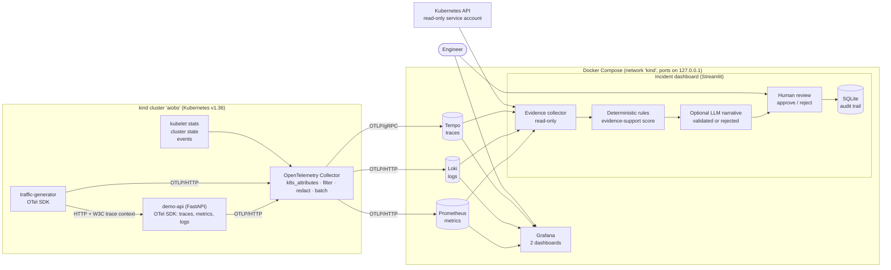
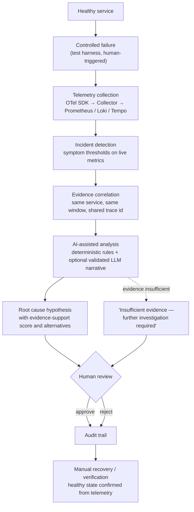

# Architecture

## Components

| Component | Runs in | Role |
|---|---|---|
| `demo-api` | Kubernetes (kind), namespace `aiobs-demo` | Instrumented FastAPI workload. Also hosts the bounded fault-injection endpoints. |
| `traffic-generator` | Kubernetes, `aiobs-demo` | Sends ~2 req/s to `demo-api` so there is always a real baseline. Instrumented client, so each request is one distributed trace across two services. |
| OpenTelemetry Collector (contrib 0.162.0) | Kubernetes, `aiobs-observability` | **Single owner of all telemetry pipelines.** Receives OTLP, collects kubelet and cluster state, enriches, filters, exports. |
| Prometheus v3.15.0 | Docker Compose | Metrics store. Ingests OTLP from the Collector; scrapes only the backends' own metrics. |
| Loki 3.7.8 | Docker Compose | Log store. Ingests OTLP. |
| Tempo 2.10.8 | Docker Compose | Trace store. Ingests OTLP gRPC. |
| Grafana 13.2.3 | Docker Compose | Dashboards and exploration; data sources and dashboards provisioned from files. |
| Incident dashboard (Streamlit) | Docker Compose | Scenario control, evidence-based analysis, human review, audit trail. Contains the `intelligence` package. |
| SQLite | file `data/incidents.db` | Incidents, analyses, review decisions, append-only audit log. |

The application runs only in Kubernetes. Docker Compose runs the supporting services.

## System diagram

## Data flow

1. `traffic-generator` calls `demo-api` through the cluster Service. The OpenTelemetry httpx instrumentation injects the W3C `traceparent` header, so the server span becomes a child of the client span.
2. Both workloads push traces, metrics and logs over OTLP/HTTP to the Collector Service (`otel-collector.aiobs-observability:4318`). Metrics are exported every 5 seconds.
3. The Collector also pulls container resource usage from the kubelet (`kubelet_stats`), workload state from the API server (`k8s_cluster`), and Kubernetes events (`k8s_objects`).
4. Processors add Kubernetes context, drop probe spans and system-namespace metrics, redact credential-looking log text, and batch.
5. Three exporters deliver each signal to exactly one backend.
6. Grafana and the evidence collector read from the backends. Nothing reads from the application directly.

## Incident investigation workflow

## Networking

Everything is local and bound to `127.0.0.1`.

| URL | What |
|---|---|
| http://localhost:18501 | Incident dashboard (Streamlit) |
| http://localhost:13000 | Grafana |
| http://localhost:19090 | Prometheus |
| http://localhost:13100 | Loki |
| http://localhost:13200 | Tempo |
| http://localhost:18080 | `demo-api`, via NodePort 30080 mapped by `kubernetes/kind-config.yaml` |
| https://127.0.0.1:16443 | Kubernetes API (kubeconfig in `.runtime/kubeconfig`) |

- **Cluster → backends.** `kind create cluster` creates a Docker network named `kind`. The Compose services join that network, so the Collector pod reaches them by container name (`aiobs-prometheus`, `aiobs-loki`, `aiobs-tempo`). No port-forwarding is needed.
- **Dashboard → cluster.** The dashboard container is on the same network and reaches the workload at `aiobs-control-plane:30080` and the API server at `aiobs-control-plane:6443`.
- **Host → cluster API.** The operations scripts run `kubectl` inside the kind node with `docker exec` instead of from the host. See [LIMITATIONS.md](LIMITATIONS.md) for why.

## Design decisions

- **One Collector, in the cluster.** The directive's reference diagram allows a simpler topology. A single in-cluster Collector gives Kubernetes-aware collection (pod metadata, kubelet, cluster state) with one config file and one owner per pipeline. A second gateway Collector in Compose would add a hop without adding a capability this POC needs.
- **Push, not scrape, for application metrics.** The app exposes no `/metrics` endpoint. Metrics, logs and traces all leave through the same OTLP exporter, so there is no second ingestion path to keep consistent.
- **One replica of `demo-api`.** Fault state lives in process memory, so a single replica keeps each scenario deterministic. The cost is that an OOM kill makes the service briefly unavailable, which is visible in the data and is part of Scenario C.
- **The analysis engine lives in the dashboard image.** No separate analysis service, queue or database server: SQLite on a bind mount is enough for one reviewer.
